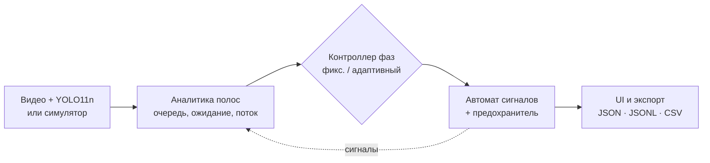
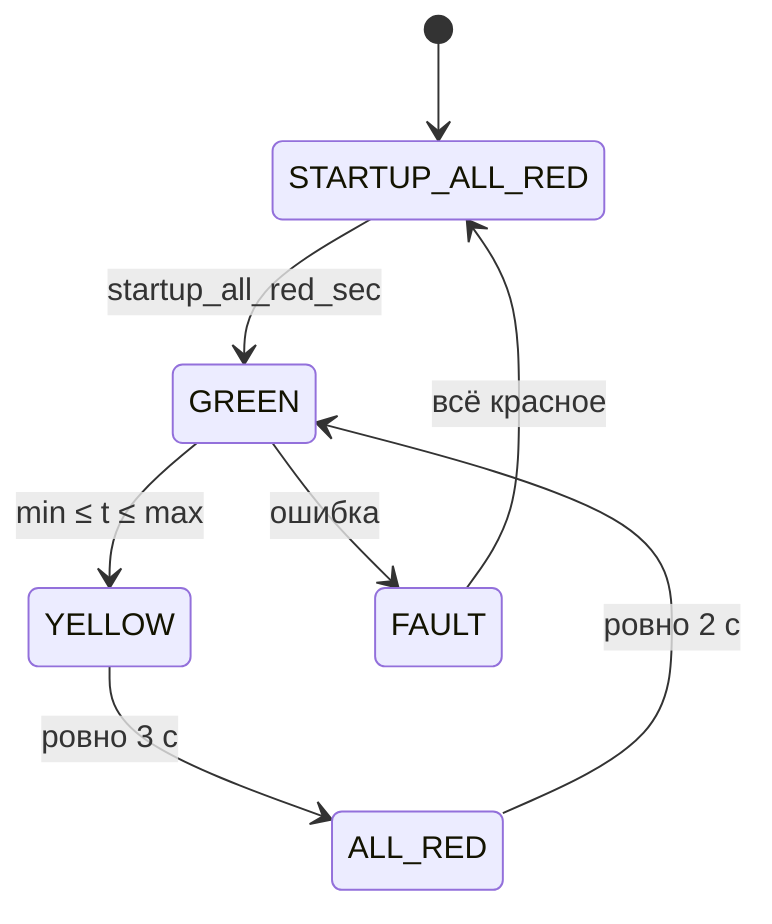

<style>
/* Глобальная тема деки: тёмный фон с мягкими градиентами и стеклянные карточки */
:global(.slidev-layout) {
  background:
    radial-gradient(900px 500px at 8% -10%, rgba(45, 212, 191, 0.16), transparent 60%),
    radial-gradient(800px 480px at 105% 110%, rgba(56, 189, 248, 0.14), transparent 60%),
    radial-gradient(600px 400px at 60% 50%, rgba(167, 139, 250, 0.06), transparent 70%),
    #0a1114;
  color: #e6eef0;
}
:global(.slidev-layout h1), :global(.slidev-layout h2) { letter-spacing: -0.02em; }
:global(.glass) {
  background: rgba(255, 255, 255, 0.045);
  border: 1px solid rgba(255, 255, 255, 0.10);
  border-radius: 1.1rem;
  backdrop-filter: blur(14px);
  -webkit-backdrop-filter: blur(14px);
  box-shadow: 0 10px 40px rgba(0, 0, 0, 0.35), inset 0 1px 0 rgba(255, 255, 255, 0.06);
}
:global(.grad) {
  background: linear-gradient(90deg, #2dd4bf, #38bdf8 55%, #a78bfa);
  -webkit-background-clip: text;
  background-clip: text;
  color: transparent;
}
:global(.eyebrow) { color: #2dd4bf; text-transform: uppercase; letter-spacing: 0.18em; font-size: 0.7rem; font-weight: 600; }
:global(.muted) { color: #9fb4b9; }
</style>

<div class="flex flex-col items-center gap-1 text-[0.82rem] leading-snug muted"
     v-motion :initial="{ opacity: 0, y: -16 }" :enter="{ opacity: 1, y: 0, transition: { duration: 700 } }">
  <div>Министерство науки, высшего образования и инноваций Кыргызской Республики</div>
  <div>Кыргызский государственный технический университет им. И.Раззакова</div>
  <div>Институт информационных технологий</div>
  <div>Кафедра «Программное обеспечение компьютерных систем»</div>
  <div>Направление: 710400 «Программная инженерия»</div>
</div>

<div class="mt-10" v-motion :initial="{ opacity: 0, scale: 0.94 }" :enter="{ opacity: 1, scale: 1, transition: { delay: 350, duration: 800 } }">
  <div class="eyebrow mb-3">Тема проекта</div>
  <h1 class="!text-4xl !font-bold !leading-tight">
    <span class="grad">ASTL</span>: адаптивное управление светофором<br>
    на основе машинного зрения и имитационного<br>моделирования перекрёстка
  </h1>
</div>

<div class="mt-10 inline-flex gap-10 glass px-8 py-4 text-sm"
     v-motion :initial="{ opacity: 0, y: 16 }" :enter="{ opacity: 1, y: 0, transition: { delay: 800, duration: 700 } }">
  <div><span class="muted">Выполнил:</span> Атамбек</div>
  <div><span class="muted">Преподаватель:</span> Жогаштиев Н.Т.</div>
</div>

<!--
Здравствуйте, уважаемая комиссия. Меня зовут Атамбек, тема моего проекта — ASTL, адаптивное управление светофором на основе машинного зрения и имитационного моделирования перекрёстка.

Коротко о том, что я покажу: какую проблему решает система, как она устроена архитектурно, как работает модуль машинного зрения, собственный симулятор перекрёстка, автомат сигналов с гарантией безопасности и адаптивный контроллер. В конце — измеренные результаты: на всех одиннадцати типах перекрёстков адаптивный режим снижает среднюю задержку на 19–62 процента по сравнению с фиксированным циклом.
-->

---
layout: default
---

<div class="eyebrow">Проблема</div>

# Светофор работает <span class="grad">по расписанию</span>, а не по спросу

<div class="grid grid-cols-2 gap-6 mt-8">
  <div v-click class="glass p-6 border-l-4 !border-l-[#ef4444]">
    <div class="text-lg font-semibold mb-3">Сейчас: фиксированный цикл</div>
    <ul class="muted text-sm space-y-2">
      <li>длительность фаз задана заранее и не меняется</li>
      <li>число ждущих машин на полосах не измеряется</li>
      <li>зелёный горит пустой дороге, на соседнем подходе растёт очередь</li>
    </ul>
  </div>
  <div v-click class="glass p-6 border-l-4 !border-l-[#2dd4bf]">
    <div class="text-lg font-semibold mb-3">Цель ASTL: управление по спросу</div>
    <ul class="muted text-sm space-y-2">
      <li>измерять очередь и ожидание <b class="text-white">по каждой полосе</b></li>
      <li>выбирать фазу по фактическому спросу</li>
      <li><b class="text-white">никогда</b> не допускать одновременного зелёного у конфликтующих потоков</li>
    </ul>
  </div>
</div>

<div v-click class="mt-8 glass px-6 py-4 text-center text-base">
  Ключевое требование: <span class="grad font-semibold">безопасность важнее эффективности</span> — адаптивность не имеет права ослабить инвариант сигналов
</div>

<!--
Начну с проблемы. Классический светофор работает по жёсткому циклу: длительность каждой фазы задана заранее. Он не знает, сколько машин стоит на каждой полосе, поэтому типичная картина — зелёный горит почти пустой дороге, а на соседнем подходе копится очередь.

Цель проекта — перейти к управлению по спросу: измерять очередь и время ожидания по каждой полосе и выбирать фазу по фактической нагрузке.

При этом я сразу зафиксировал главное инженерное требование: безопасность важнее эффективности. Никакая адаптивная логика не имеет права допустить, чтобы два конфликтующих потока одновременно получили разрешающий сигнал. Дальше я покажу, как это обеспечено архитектурно, а не «на честном слове».
-->

---
layout: default
---

<div class="eyebrow">Дорожная карта</div>

# Проект в <span class="grad">четыре этапа</span>

<div class="grid grid-cols-4 gap-4 mt-10">
  <div v-click class="glass p-5 border-t-4 !border-t-[#2dd4bf]">
    <div class="text-xs font-semibold text-[#2dd4bf] mb-2">ГОТОВО</div>
    <div class="font-semibold mb-2">1. Машинное зрение</div>
    <div class="muted text-xs leading-relaxed">YOLO11n + ByteTrack: пополосный анализ реального видео</div>
  </div>
  <div v-click class="glass p-5 border-t-4 !border-t-[#2dd4bf]">
    <div class="text-xs font-semibold text-[#2dd4bf] mb-2">ГОТОВО</div>
    <div class="font-semibold mb-2">2. Симуляция</div>
    <div class="muted text-xs leading-relaxed">автомат сигналов и адаптивный контроллер одного перекрёстка</div>
  </div>
  <div v-click class="glass p-5 border-t-4 !border-t-[#64748b]">
    <div class="text-xs font-semibold muted mb-2">ПЛАН</div>
    <div class="font-semibold mb-2">3. Зелёная волна</div>
    <div class="muted text-xs leading-relaxed">координация нескольких перекрёстков</div>
  </div>
  <div v-click class="glass p-5 border-t-4 !border-t-[#f5a623]">
    <div class="text-xs font-semibold text-[#f5a623] mb-2">НАЧАТ</div>
    <div class="font-semibold mb-2">4. Физический макет</div>
    <div class="muted text-xs leading-relaxed">Raspberry Pi + светодиоды через GPIO; плата уже есть</div>
  </div>
</div>

<div v-click class="mt-8 text-center muted text-sm">
  Формат данных этапа 2 уже содержит сигнал каждой группы — это интерфейс для этапов 3 и 4
</div>

<!--
Проект декомпозирован на четыре этапа, каждый из которых даёт законченный, проверяемый результат.

Первый этап — машинное зрение: анализ реального видео с перекрёстка по каждой полосе. Второй — имитационная модель одного перекрёстка с автоматом сигналов и адаптивным контроллером. Оба этапа готовы и покрыты тестами.

Третий этап — координация нескольких перекрёстков, так называемая «зелёная волна». Четвёртый — физический макет на Raspberry Pi: плата у нас уже есть, светодиоды будут управляться через GPIO.

Важная деталь архитектуры: формат снимка состояния, который выдаёт симулятор, уже содержит сигнал каждой сигнальной группы. То есть интерфейс для будущего драйвера GPIO и модуля координации заложен заранее — их не придётся встраивать в чужой код.
-->

---
layout: default
---

<div class="eyebrow">Архитектура</div>

# Один конвейер для <span class="grad">видео и модели</span>

<div class="grid grid-cols-5 gap-6 mt-4 items-center">
<div class="col-span-3">



</div>
<div class="col-span-2 space-y-3">
  <div v-click class="glass p-4">
    <div class="font-semibold text-sm mb-1">Единый формат снимка</div>
    <div class="muted text-xs">симулятор выдаёт те же поля, что и видео-пайплайн — UI и графики общие</div>
  </div>
  <div v-click class="glass p-4">
    <div class="font-semibold text-sm mb-1">Контроллер ≠ автомат</div>
    <div class="muted text-xs">контроллер только предлагает решение; тайминги и безопасность гарантирует автомат</div>
  </div>
  <div v-click class="glass p-4">
    <div class="font-semibold text-sm mb-1">Фоновые worker'ы</div>
    <div class="muted text-xs">один паттерн JobWorker для видео и симуляции; пауза останавливает модельное время</div>
  </div>
</div>
</div>

<!--
Архитектурно система — это один конвейер. На входе — либо реальное видео, которое обрабатывает детектор YOLO11n, либо мой симулятор. Дальше — пополосная аналитика, контроллер фаз и автомат сигналов, а на выходе — интерфейс и экспорт в JSON, JSONL и CSV.

Три решения, на которых всё держится.

Первое — единый формат снимка. Симулятор генерирует данные с теми же именами полей, что и видео-пайплайн: vehicles, queued, avg_wait_sec и так далее. Поэтому карточки полос, графики очереди и журнал событий из первого этапа переиспользуются без изменений. Схема версионирована: снимок версии 1.1 — обратно совместимое надмножество версии 1.0.

Второе — разделение контроллера и автомата. Контроллер только предлагает: «закончить зелёный, следующая фаза такая-то». Минимальный и максимальный зелёный, жёлтый, all-red и проверку конфликтов обеспечивает автомат. Это значит, что даже ошибочный контроллер не может сделать систему опасной.

Третье — фоновые worker'ы по одному паттерну: одна активная задача, своя папка результатов, а пауза останавливает модельное время, а не только отрисовку.
-->

---
layout: default
---

<div class="eyebrow">Технологический стек</div>

# Bento: <span class="grad">из чего собрана система</span>

<div class="grid grid-cols-4 grid-rows-2 gap-4 mt-6 h-[340px]">
  <div v-click class="glass p-5 col-span-2 row-span-1 flex flex-col justify-between">
    <div class="eyebrow !text-[#38bdf8]">Backend</div>
    <div class="text-2xl font-bold">Python 3.11 · FastAPI</div>
    <div class="muted text-xs">Pydantic 2 — схемы и жёсткая валидация · Uvicorn · фоновые потоки</div>
  </div>
  <div v-click class="glass p-5 col-span-2 row-span-1 flex flex-col justify-between">
    <div class="eyebrow">Машинное зрение</div>
    <div class="text-2xl font-bold">YOLO11n + ByteTrack</div>
    <div class="muted text-xs">Ultralytics · OpenCV · PyTorch CPU · ffmpeg → H.264</div>
  </div>
  <div v-click class="glass p-5 flex flex-col justify-between">
    <div class="eyebrow !text-[#a78bfa]">Frontend</div>
    <div class="text-xl font-bold">React 19 · TS</div>
    <div class="muted text-xs">Vite · Tailwind 4</div>
  </div>
  <div v-click class="glass p-5 flex flex-col justify-between">
    <div class="eyebrow !text-[#a78bfa]">Визуализация</div>
    <div class="text-xl font-bold">SVG · Recharts</div>
    <div class="muted text-xs">Konva — редактор разметки</div>
  </div>
  <div v-click class="glass p-5 flex flex-col justify-between">
    <div class="eyebrow !text-[#f5a623]">Симулятор</div>
    <div class="text-xl font-bold">Свой движок</div>
    <div class="muted text-xs">шаг 0.1 с, без SUMO</div>
  </div>
  <div v-click class="glass p-5 flex flex-col justify-between">
    <div class="eyebrow !text-[#f5a623]">Качество</div>
    <div class="text-xl font-bold">634 теста</div>
    <div class="muted text-xs">pytest · офлайн · CPU</div>
  </div>
</div>

<!--
Стек. Backend — Python 3.11 и FastAPI; Pydantic второй версии отвечает за схемы данных и жёсткую валидацию: сломанный профиль перекрёстка сервер просто не примет.

Машинное зрение — Ultralytics YOLO11n для детекции и ByteTrack для трекинга, OpenCV для работы с кадрами. Всё работает на обычном CPU, CUDA подхватывается автоматически, если есть. Результат перекодируется в H.264 через ffmpeg, чтобы видео открывалось в браузере.

Frontend — React 19 на TypeScript, Vite и Tailwind. Схема перекрёстка нарисована на SVG, графики — Recharts, редактор разметки видео — Konva.

Симулятор я написал сам, без SUMO: для одного перекрёстка полноценный микросимулятор — избыточная и плохо контролируемая зависимость. И наконец, 634 автотеста. Вся система работает полностью офлайн: без облака и внешних API.
-->

---
layout: default
---

<div class="eyebrow">Этап 1 · машинное зрение</div>

# Пополосный анализ <span class="grad">реального видео</span>

<div class="grid grid-cols-3 gap-5 mt-6">
  <div v-click class="glass p-5 col-span-2">
    <div class="font-semibold mb-3">Как это работает</div>
    <v-clicks>

- Разметка полос, зон очереди и линий подсчёта **поверх кадра** (нормированные координаты)
- **YOLO11n** находит машины, **ByteTrack** ведёт каждую между кадрами
- По полосе: машин сейчас, очередь, ожидание сред./макс., поток за 60 с, состав
- Пересечение линии засчитывается **один раз на трек** — защита от дрожания рамки

    </v-clicks>
  </div>
  <div class="flex flex-col gap-5">
    <div v-click class="glass p-5 text-center">
      <div class="text-4xl font-bold grad">27–30</div>
      <div class="muted text-xs mt-1">кадров/с на CPU без GPU</div>
    </div>
    <div v-click class="glass p-5 text-center">
      <div class="text-4xl font-bold grad">5 / 5</div>
      <div class="muted text-xs mt-1">машин в пробке в очереди после исправления (было 4/5)</div>
    </div>
    <div v-click class="glass p-5 text-center">
      <div class="text-4xl font-bold grad">275</div>
      <div class="muted text-xs mt-1">уникальных ID вместо 363</div>
    </div>
  </div>
</div>

<!--
Первый этап — анализ реального видео. Пользователь размечает полосы, зоны очереди и линии подсчёта прямо на кадре. Координаты нормированы относительно разрешения, поэтому разметка не «едет» при изменении размера окна.

YOLO11n находит машины, ByteTrack присваивает им устойчивые идентификаторы. По каждой полосе считаются машины сейчас, длина очереди, среднее и максимальное ожидание, поток за минуту и состав транспорта. Пересечение линии засчитывается не более одного раза на трек — это защита от ложного счёта при дрожании рамки детектора.

Производительность — 27–30 кадров в секунду на обычном процессоре.

Отдельно — исправление логики очереди. Ожидание сбрасывалось по четырём причинам: дрейф рамки у стоящей машины, потеря трека, смена ID и слишком низкий порог выхода из очереди. После исправления в тестовой пробке в очередь попадают все пять машин из пяти, а число уникальных ID упало с 363 до 275 — то есть трекер перестал «перерождать» одну и ту же машину.
-->

---
layout: default
---

<div class="eyebrow">Этап 2 · имитационная модель</div>

# Собственный <span class="grad">дискретный симулятор</span>

<div class="grid grid-cols-5 gap-6 mt-4">
<div class="col-span-2 space-y-3">
  <div v-click class="glass p-4">
    <div class="font-semibold text-sm">Шаг 0.1 с, время — в тиках</div>
    <div class="muted text-xs">нет системных часов → пауза и ускорение не меняют результат</div>
  </div>
  <div v-click class="glass p-4">
    <div class="font-semibold text-sm">Пуассоновский поток на полосу</div>
    <div class="muted text-xs">свой генератор random.Random(f"{seed}|{lane}") → один seed = один трафик в обоих режимах</div>
  </div>
  <div v-click class="glass p-4">
    <div class="font-semibold text-sm">Кинематика без столкновений</div>
    <div class="muted text-xs">разгон, свободное движение, торможение до препятствия — по построению</div>
  </div>
</div>
<div class="col-span-3" v-click>

```python {1|2|3-4|6-9}
d = max(0.0, obstacle - v.pos)
v_new = min(v.speed + v.accel * dt, v.vmax, math.sqrt(2 * v.decel * d), d / dt)
v_new = max(0.0, v_new)
new_pos = v.pos + v_new * dt

if not v.crossed and new_pos > stop_line and sig == RED:
    # страховка: на красном стоп-линию не пересечь
    self.red_clamps += 1
    new_pos, v_new = stop_line, 0.0
```

<div class="muted text-xs mt-2">backend/app/simulation/engine.py — `red_clamps` во всех прогонах = 0</div>
</div>
</div>

<!--
Второй этап — собственный дискретный симулятор. Модель считает каждые 0,1 секунды, и всё время хранится в целых тиках. В модели нет ни одного обращения к системным часам — это проверено тестом. Поэтому пауза, ускорение ×50 или медленный компьютер не меняют результат: прогон в реальном времени с паузами и прогон «как можно быстрее» дают одинаковый отпечаток траекторий.

Трафик — пуассоновский поток на каждой полосе. У каждой полосы свой генератор случайных чисел, засеянный строкой seed плюс ID полосы. Это критично для честного сравнения: при одном seed фиксированный и адаптивный режим получают ровно одни и те же машины.

Посмотрите на код. Расстояние до ближайшего препятствия — задний бампер впереди идущей машины или стоп-линия на красном. Новая скорость — минимум из четырёх ограничений: разгон, предел скорости, скорость, с которой ещё можно затормозить до препятствия, и шаг, не перескакивающий препятствие. Столкновение и проезд на красный невозможны по построению. Ниже — дополнительная страховка на красном; её счётчик во всех прогонах равен нулю.
-->

---
layout: default
---

<div class="eyebrow">Ядро безопасности</div>

# Автомат состояний <span class="grad">с предохранителем</span>

<div class="grid grid-cols-2 gap-6 mt-2 items-start">
<div>



</div>
<div class="space-y-3">
<div v-click>

```python {2|3-7|8}
def _apply_signals(self, new_signals):
    if not self.is_safe(new_signals):
        self.blocked_violations += 1
        bad = sorted("/".join(sorted(pair))
                     for pair in self.conflicts
                     if pair <= permissive(new_signals))
        raise SafetyViolation(f"заблокировано: {bad}")
    self.signals = new_signals
```

</div>
  <div v-click class="glass p-4 flex items-center gap-4">
    <div class="text-4xl font-bold grad">0</div>
    <div class="muted text-xs">нарушений на 150 случайных перекрёстках с <b class="text-white">хаотичным</b> контроллером × 3000 тиков</div>
  </div>
</div>
</div>

<!--
Это ядро всей системы. Сигналы переключаются явным автоматом состояний с таблицей допустимых переходов: старт со всем красным, зелёный фазы — не меньше минимального и не больше максимального, ровно три секунды жёлтого, ровно две секунды всего красного, затем следующая фаза. Любая ошибка — переход в FAULT, все сигналы красные, перезапуск.

Безопасность обеспечена двумя независимыми слоями. Первый — структурный: зелёный включается только из полностью красного состояния и только для групп одной фазы, а валидация не пропускает фазу с конфликтующими группами.

Второй слой — предохранитель, его код справа. Абсолютно каждая смена сигналов проходит через эту функцию. Если новый набор сигналов нарушает матрицу конфликтов, он не применяется ни на один тик: растёт счётчик, и автомат уходит в FAULT. Это проверено тестом на профиле, специально собранном в обход валидации.

Самый сильный тест — 150 случайных перекрёстков со случайной матрицей конфликтов и «хаотичным» контроллером, который принимает случайные решения. Ноль нарушений.
-->

---
layout: default
---

<div class="eyebrow">Адаптивный контроллер</div>

# Когда <span class="grad">заканчивать зелёный</span>

<div class="grid grid-cols-2 gap-6 mt-4">
<div>
<v-clicks>

<div class="glass p-3 mb-3 text-sm"><b class="text-[#2dd4bf]">1 · Защита от голодания</b> <span class="muted">— машина ждёт почти 90 с → её фаза строго следующая</span></div>
<div class="glass p-3 mb-3 text-sm"><b class="text-[#2dd4bf]">2 · Gap-out</b> <span class="muted">— машины фазы перестали проезжать детектор ≥ 3 с → уступить</span></div>
<div class="glass p-3 mb-3 text-sm"><b class="text-[#2dd4bf]">3 · Очистка очереди</b> <span class="muted">— очередь разъехалась, напротив ждут ≥ 2 машин → уступить</span></div>
<div class="glass p-3 text-sm"><b class="text-[#2dd4bf]">4 · Иначе продлевать</b> <span class="muted">— но всегда min ≤ зелёный ≤ max</span></div>

</v-clicks>
</div>
<div class="space-y-4">
<div v-click class="glass p-5">
<div class="muted text-xs mb-2">Спрос фазы по ждущим машинам, w = 0.1 1/с</div>

$$
D(p) = \sum_{g \in p} \; \sum_{v \in Q(g)} \left(1 + w \cdot t_v^{\text{wait}}\right)
$$

<div class="muted text-xs">Следующая — фаза с наибольшим D; машина, ждущая 10 с, весит как две</div>
</div>
<div v-click>

```python
if queued == 0 and best_other >= threshold:
    return Decision(True, "queue_clear", nxt)
```

</div>
</div>
</div>

<!--
Адаптивный контроллер отвечает на один вопрос: когда заканчивать зелёный. Правила проверяются строго по порядку и только после минимального зелёного.

Первое — защита от голодания. Если какая-то машина ждёт так долго, что с учётом жёлтого и all-red опоздает за порог 90 секунд, её фаза обязательно следующая. Валидация гарантирует, что порог физически достижим, а тест перебирает 200 моментов цикла и подтверждает гарантию в каждом.

Второе — классический gap-out: машины фазы перестали проезжать виртуальный детектор дольше трёх секунд — держать зелёный бессмысленно.

Третье правило я добавил по результатам эксперимента: на многополосных фазах машины с разных полос проезжают детектор почти непрерывно, gap-out не срабатывает, и зелёный тянулся до максимума. Правило «очистка очереди»: стоявшая очередь разъехалась, а напротив ждут хотя бы две машины — уступаем.

Выбор следующей фазы — по спросу, формула справа: каждая ждущая машина плюс вес за время ожидания. Я честно называю это эвристикой, а не оптимальным алгоритмом: это не max-pressure и не обучение с подкреплением.
-->

---
layout: default
---

<div class="eyebrow">Результаты</div>

# Задержка ниже на <span class="grad">всех 11 шаблонах</span>

<div class="flex gap-4 text-xs muted mt-1 mb-3">
  <span class="flex items-center gap-1"><span class="inline-block w-4 h-2 rounded bg-[#64748b]"></span> фиксированный</span>
  <span class="flex items-center gap-1"><span class="inline-block w-4 h-2 rounded bg-[#2dd4bf]"></span> адаптивный</span>
  <span>· средняя задержка, с · 5 seed × 1 ч · одинаковый трафик</span>
</div>

<v-clicks>
<div class="grid grid-cols-[13rem_1fr_7.5rem] items-center gap-3 text-xs mb-1"><span>4-подходный простой</span><div><div class="h-1.5 rounded bg-[#64748b]" style="width:13%"></div><div class="h-1.5 mt-0.5 rounded bg-[#2dd4bf]" style="width:8%"></div></div><span class="text-right">12.4 → 7.6 <b class="text-[#2dd4bf]">−39%</b></span></div>
<div class="grid grid-cols-[13rem_1fr_7.5rem] items-center gap-3 text-xs mb-1"><span>С выделенными левыми</span><div><div class="h-1.5 rounded bg-[#64748b]" style="width:65.5%"></div><div class="h-1.5 mt-0.5 rounded bg-[#2dd4bf]" style="width:24.5%"></div></div><span class="text-right">62.5 → 23.4 <b class="text-[#2dd4bf]">−62%</b></span></div>
<div class="grid grid-cols-[13rem_1fr_7.5rem] items-center gap-3 text-xs mb-1"><span>T-образный</span><div><div class="h-1.5 rounded bg-[#64748b]" style="width:21.2%"></div><div class="h-1.5 mt-0.5 rounded bg-[#2dd4bf]" style="width:10.5%"></div></div><span class="text-right">20.2 → 10.0 <b class="text-[#2dd4bf]">−51%</b></span></div>
<div class="grid grid-cols-[13rem_1fr_7.5rem] items-center gap-3 text-xs mb-1"><span>4 подхода, 3 полосы</span><div><div class="h-1.5 rounded bg-[#64748b]" style="width:32.2%"></div><div class="h-1.5 mt-0.5 rounded bg-[#2dd4bf]" style="width:22.2%"></div></div><span class="text-right">30.7 → 21.2 <b class="text-[#2dd4bf]">−31%</b></span></div>
<div class="grid grid-cols-[13rem_1fr_7.5rem] items-center gap-3 text-xs mb-1"><span>3 полосы, расщеплённые фазы</span><div><div class="h-1.5 rounded bg-[#64748b]" style="width:31.3%"></div><div class="h-1.5 mt-0.5 rounded bg-[#2dd4bf]" style="width:22.5%"></div></div><span class="text-right">29.9 → 21.5 <b class="text-[#2dd4bf]">−28%</b></span></div>
<div class="grid grid-cols-[13rem_1fr_7.5rem] items-center gap-3 text-xs mb-1"><span>3 полосы: утро / вечер / ночь</span><div><div class="h-1.5 rounded bg-[#64748b]" style="width:100%"></div><div class="h-1.5 mt-0.5 rounded bg-[#2dd4bf]" style="width:75.2%"></div></div><span class="text-right">95.4 → 71.7 <b class="text-[#2dd4bf]">−25%</b></span></div>
<div class="grid grid-cols-[13rem_1fr_7.5rem] items-center gap-3 text-xs mb-1"><span>Магистраль × второстепенная</span><div><div class="h-1.5 rounded bg-[#64748b]" style="width:26.7%"></div><div class="h-1.5 mt-0.5 rounded bg-[#2dd4bf]" style="width:14.4%"></div></div><span class="text-right">25.5 → 13.7 <b class="text-[#2dd4bf]">−46%</b></span></div>
<div class="grid grid-cols-[13rem_1fr_7.5rem] items-center gap-3 text-xs mb-1"><span>T-образный, главная 3 полосы</span><div><div class="h-1.5 rounded bg-[#64748b]" style="width:16.9%"></div><div class="h-1.5 mt-0.5 rounded bg-[#2dd4bf]" style="width:11.6%"></div></div><span class="text-right">16.1 → 11.1 <b class="text-[#2dd4bf]">−31%</b></span></div>
<div class="grid grid-cols-[13rem_1fr_7.5rem] items-center gap-3 text-xs mb-1"><span>Две односторонние улицы</span><div><div class="h-1.5 rounded bg-[#64748b]" style="width:16.9%"></div><div class="h-1.5 mt-0.5 rounded bg-[#2dd4bf]" style="width:13.7%"></div></div><span class="text-right">16.1 → 13.1 <b class="text-[#2dd4bf]">−19%</b></span></div>
<div class="grid grid-cols-[13rem_1fr_7.5rem] items-center gap-3 text-xs mb-1"><span>Асимметричный, короткие подходы</span><div><div class="h-1.5 rounded bg-[#64748b]" style="width:39.7%"></div><div class="h-1.5 mt-0.5 rounded bg-[#2dd4bf]" style="width:20%"></div></div><span class="text-right">37.9 → 19.1 <b class="text-[#2dd4bf]">−50%</b></span></div>
<div class="grid grid-cols-[13rem_1fr_7.5rem] items-center gap-3 text-xs"><span>Бульвар со сдвоенными левыми</span><div><div class="h-1.5 rounded bg-[#64748b]" style="width:39.4%"></div><div class="h-1.5 mt-0.5 rounded bg-[#2dd4bf]" style="width:28.9%"></div></div><span class="text-right">37.6 → 27.6 <b class="text-[#2dd4bf]">−27%</b></span></div>
</v-clicks>

<!--
Главный результат. Я сравнил фиксированный и адаптивный режим на всех одиннадцати шаблонах перекрёстков: от простого двухфазного до бульвара с четырьмя полосами и сдвоенными левыми поворотами. На каждый шаблон — пять разных seed по одному часу модельного времени, и в обоих режимах ровно один и тот же трафик.

Средняя задержка на машину снизилась везде: от 19 процентов на пересечении односторонних улиц до 62 процентов на перекрёстке с выделенными левыми поворотами. В 54 случаях из 55 адаптивный режим не хуже фиксированного.

Пропускная способность в обоих режимах одинакова — потому что спрос ниже ёмкости, и проезжают все пришедшие машины. Выигрыш именно во времени, которое каждая машина теряет у светофора.

Во всех 110 прогонах счётчики предохранителя, FAULT и страховки на красном равны нулю.
-->

---
layout: default
---

<div class="eyebrow">Инженерная честность</div>

# Проверка качества <span class="grad">и ограничения</span>

<div class="grid grid-cols-3 gap-5 mt-6">
  <div v-click class="glass p-6 flex flex-col justify-between">
    <div>
      <div class="text-6xl font-bold grad">634</div>
      <div class="muted text-sm mt-1">автотеста, оба этапа</div>
    </div>
    <div class="mt-6">
      <div class="text-4xl font-bold text-[#f5a623]">4</div>
      <div class="muted text-sm">реальных бага нашли сами тесты</div>
    </div>
  </div>
  <div v-click class="glass p-6">
    <div class="font-semibold mb-3">Что доказано тестами</div>
    <ul class="muted text-sm space-y-1.5">
      <li>конфликты — на случайных профилях</li>
      <li>тайминги — с точностью до тика</li>
      <li>голодание — 200 точек цикла</li>
      <li>детерминизм по seed</li>
      <li>пауза не двигает время</li>
      <li>UI — в headless Chrome</li>
    </ul>
  </div>
  <div v-click class="glass p-6 border !border-[#f5a623]/40">
    <div class="font-semibold mb-3">Ограничения</div>
    <ul class="muted text-sm space-y-1.5">
      <li>учебная модель, не сертифицированный контроллер</li>
      <li>кинематика упрощена, не откалибрована</li>
      <li>«утро/вечер/ночь»: больше остановок</li>
      <li>левые повороты иногда ждут дольше</li>
    </ul>
  </div>
</div>

<!--
О качестве. В проекте 634 автотеста, и это не формальность: тесты нашли четыре реальных бага, которые я исправил. Например, рандомизированный тест нашёл, что профиль с одной фазой уходил в аварийный режим, а перебор моментов цикла показал, что защита от голодания опаздывала на одну десятую секунды из-за момента журналирования перехода. Ещё один тест поймал гонку при завершении прогона.

Что доказано: безопасность на случайных профилях, тайминги с точностью до тика, гарантия защиты от голодания, детерминизм, корректность паузы. Интерфейс проверен автоматическим проходом в headless Chrome на всех шаблонах.

И честно об ограничениях. Это учебная модель логики, а не сертифицированный дорожный контроллер. Кинематика упрощённая и не откалибрована по реальному перекрёстку, поэтому важны относительные, а не абсолютные цифры. И адаптивный режим не идеален: в сценарии с пиками у него больше остановок, а редкие левые повороты иногда ждут дольше, чем в фиксированном цикле.
-->

---
layout: center
class: text-center
---

<div class="eyebrow mb-4">Итоги</div>

# <span class="grad">Безопасно. Измеримо. Быстрее на 19–62%.</span>

<div class="grid grid-cols-3 gap-5 mt-10 text-left">
  <div v-click class="glass p-5">
    <div class="font-semibold mb-2">Сделано</div>
    <div class="muted text-xs leading-relaxed">анализ видео на CPU, свой симулятор, автомат сигналов с предохранителем, адаптивный контроллер, 11 шаблонов</div>
  </div>
  <div v-click class="glass p-5">
    <div class="font-semibold mb-2">Этап 3</div>
    <div class="muted text-xs leading-relaxed">«зелёная волна»: согласование фаз нескольких перекрёстков</div>
  </div>
  <div v-click class="glass p-5 border !border-[#f5a623]/40">
    <div class="font-semibold mb-2">Этап 4</div>
    <div class="muted text-xs leading-relaxed">Raspberry Pi уже есть: светодиоды через GPIO по тому же автомату сигналов</div>
  </div>
</div>

<div v-click class="mt-12 text-3xl font-bold">Спасибо! Готов ответить на вопросы</div>

<!--
Подведу итог. Сделаны два этапа из четырёх: анализ реального видео по полосам на обычном процессоре и имитационная модель перекрёстка с автоматом сигналов, предохранителем и адаптивным контроллером. Результат — средняя задержка ниже на 19–62 процента на всех одиннадцати типах перекрёстков, при доказанной тестами безопасности.

Дальше — третий этап, «зелёная волна»: согласование фаз нескольких соседних перекрёстков. И четвёртый — физический макет: Raspberry Pi у нас уже есть, светодиоды будут управляться через GPIO тем же самым автоматом сигналов, который сейчас работает в симуляторе. Формат данных для этого уже заложен.

Спасибо за внимание, готов ответить на ваши вопросы.
-->
